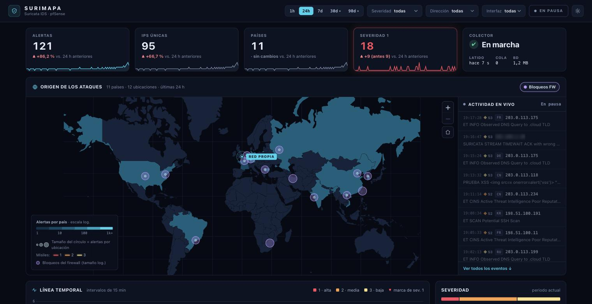
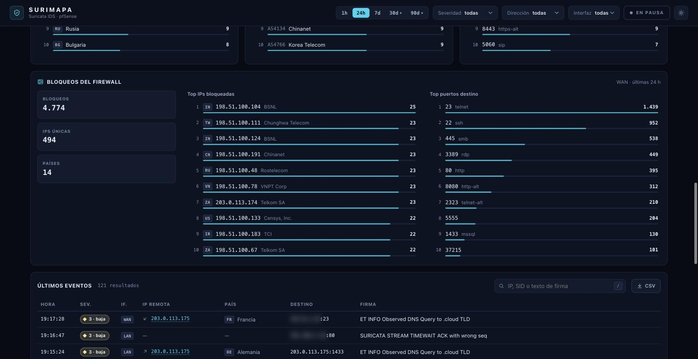
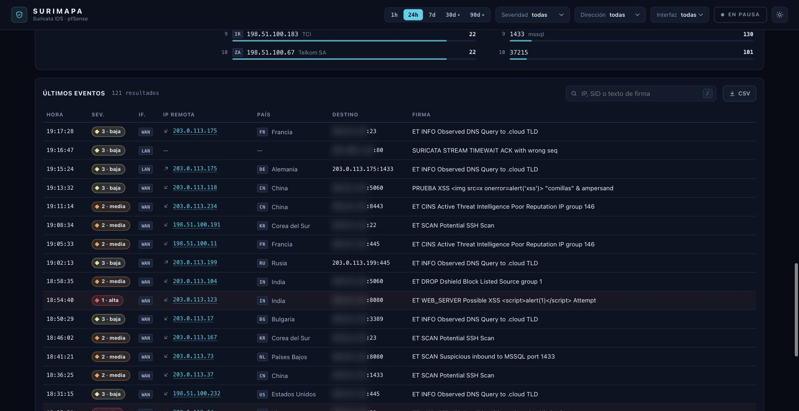
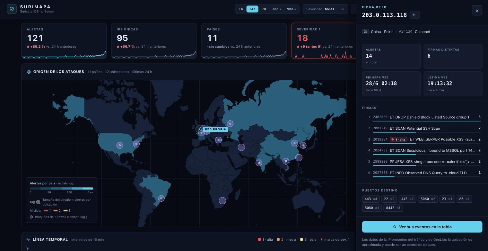
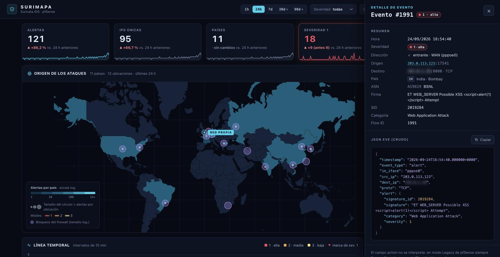
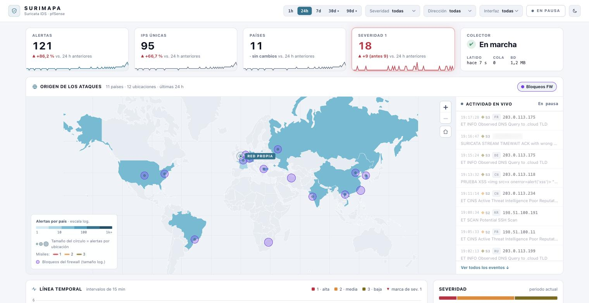

# Surimapa

[English](README.md) · **Español**

Un portal web ligero y autoalojado para **ver los ataques que detecta tu IDS Suricata**: mapa mundial, líneas de tiempo, rankings y una tabla de eventos con búsqueda. También muestra **los paquetes que bloquea el firewall de pfSense**.

Es una versión pequeña, a escala de homelab, de la pila habitual *Redis + Vector + Loki + Grafana*. Usa unas pocas piezas sencillas que corren en Docker con unos **150–250 MB de RAM**.



| | |
|---|---|
|  Bloqueos del firewall |  Tabla de eventos con búsqueda y exportación CSV |
|  Ficha de IP |  Detalle de evento con el JSON EVE crudo |
|  Tema claro | |

*Las capturas usan datos sintéticos (rangos IP de documentación); las IP locales y propias están difuminadas.*

---

## Qué hace

- **Mapa mundial** del origen de los ataques:
  - países coloreados en escala logarítmica y círculos por ciudad;
  - «misiles» animados desde el atacante hasta tu red con las alertas en vivo;
  - clic en un país o en un círculo para filtrar la tabla de eventos.
- **Capa del firewall** (opcional): paquetes bloqueados por pfSense en la WAN, recibidos por syslog. Se dibujan como segunda capa del mismo mapa y tienen su propia tarjeta (totales, top de IPs, top de puertos).
- **Indicadores** con comparación con el periodo anterior, salud del colector, reparto por severidad y línea temporal con marcas de severidad 1.
- **Rankings**: firmas, IPs remotas (con la organización del AS), países, ASN y puertos destino.
- **Tabla de eventos**:
  - búsqueda por IP, SID o texto de la firma;
  - filtros por periodo, severidad, sentido e interfaz, y paginación;
  - **exportación a CSV** de la vista actual;
  - panel lateral con el JSON EVE completo (reducido) y la **ficha de cada IP**.
- **Modo en vivo** mediante Server-Sent Events.
- Tema oscuro y claro, y diseño para móvil.

La interfaz está en **español**; la documentación, en español e inglés.

## Cómo funciona

```
 Suricata (pfSense, OPNsense, Linux…) ──EVE JSON──► Redis (lista) ──► colector ──► SQLite ◄── portal ──► navegador
 Firewall de pfSense ──filterlog por syslog UDP──────────────────────► colector        (FastAPI + JS vanilla)
                                                    GeoLite2 (MaxMind) ──┘
```

| Pieza | Función | Tecnología |
|---|---|---|
| `redis` | Buffer en el que escribe Suricata (lista, LPUSH) | `redis:7-alpine` con ACL |
| `collector` | Lee las alertas, las valida y normaliza, añade GeoIP (país, ciudad, ASN) y las guarda. También escucha el syslog del firewall y se encarga de la retención y la copia diaria | Python 3.12 |
| SQLite | Almacenamiento (WAL, índices cubrientes) | un solo fichero |
| `portal` | API REST + SSE + interfaz estática de una página (Leaflet y Chart.js, sin framework ni CDN) | FastAPI |
| `geoipupdate` | Mantiene al día las bases gratuitas GeoLite2 | imagen oficial de MaxMind |

## Modelo de seguridad

Surimapa maneja **datos no confiables**: un atacante controla buena parte de lo que registra un IDS.

- **Datos en el servidor:**
  - solo SQL parametrizado;
  - cada campo se valida con rigor;
  - los textos se truncan y se eliminan los caracteres de control;
  - **nunca se guardan los payloads** de los paquetes.
- **Interfaz:**
  - inserta los datos solo con `textContent` (nunca `innerHTML`);
  - funciona bajo una Content-Security-Policy estricta (`default-src 'self'`) y no hace peticiones a terceros.
- **Acceso al portal:**
  - pantalla de acceso: la contraseña solo se guarda como hash scrypt y cada fallo tiene una espera;
  - cookie de sesión `Secure`/`HttpOnly`/`SameSite=Strict` y comprobación de origen en los POST;
  - no arranca sin credenciales y se sirve solo a través de un proxy inverso con HTTPS;
  - **no lo expongas a Internet**: úsalo en tu LAN o a través de una VPN (WireGuard, Tailscale…).
- **Redis usa ACL:** el usuario anónimo (Suricata) solo puede hacer `LPUSH`/`RPUSH`/`PING` sobre la clave de alertas; leer exige contraseña.
- **Syslog del firewall:** el receptor solo acepta datagramas de la IP del firewall configurada.
- **Contenedores:** corren con un usuario sin privilegios y con límites de memoria.

## Primeros pasos

1. Lee la **[guía de despliegue](docs/es/DESPLIEGUE.md)**: Docker Compose en cualquier Linux o NAS, con notas para Synology.
2. Envíale datos siguiendo la **[guía de fuentes de datos](docs/es/FUENTES.md)**: pfSense, OPNsense, Suricata independiente, UniFi y otros.
3. Referencia de la API: **[docs/es/API.md](docs/es/API.md)**.

Para echar un vistazo sin ningún firewall (datos sintéticos; solo hace falta Python 3):

```bash
python3 scripts/mock_api.py      # y abre http://127.0.0.1:8099
```

## Desarrollo

```bash
# tests (el mismo Python que los contenedores)
docker run --rm -v "$PWD":/src:ro -w /src -e PYTHONDONTWRITEBYTECODE=1 python:3.12-slim \
  sh -c 'pip install -q pytest -r deploy/collector/requirements.txt -r deploy/portal/requirements.txt httpx && python -m pytest -q -p no:cacheprovider tests'

# inyectar alertas EVE de ejemplo en un Redis local (requiere: pip install redis)
python3 scripts/send_test_events.py --redis-url redis://127.0.0.1:6379/0 --count 200 --rate 20
```

## Licencia

Surimapa es software libre bajo la **GNU General Public License v3.0**: ver [LICENSE](LICENSE).
Los componentes de terceros incluidos mantienen sus propias licencias: ver [THIRD_PARTY.md](THIRD_PARTY.md).

Este producto incluye datos GeoLite2 creados por MaxMind, disponibles en <https://www.maxmind.com>. Cada instalación los descarga con su propia cuenta gratuita; no se incluyen en este repositorio.
