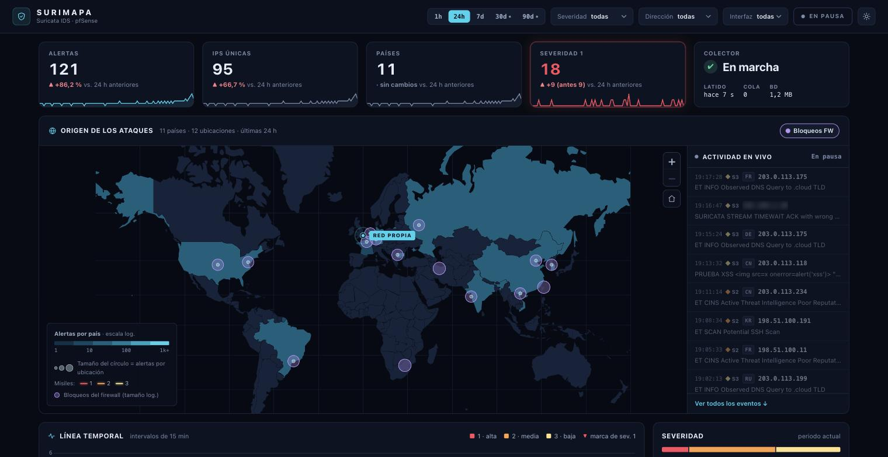
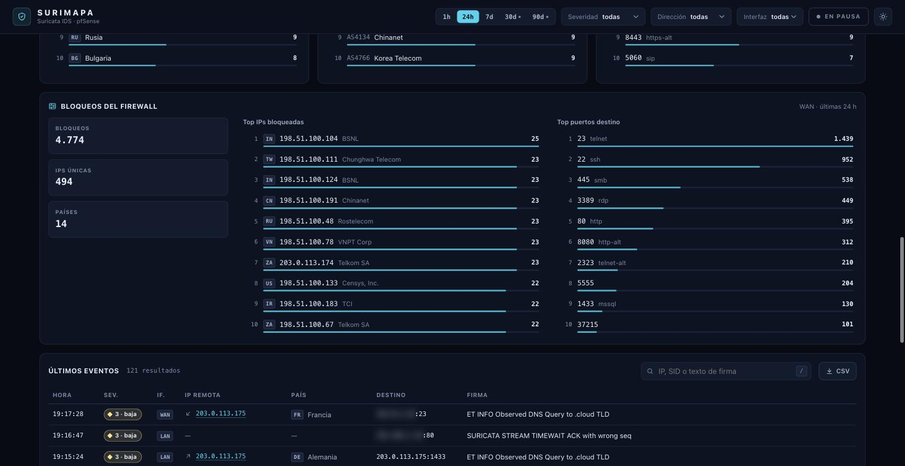
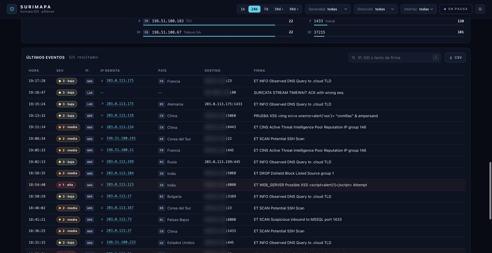
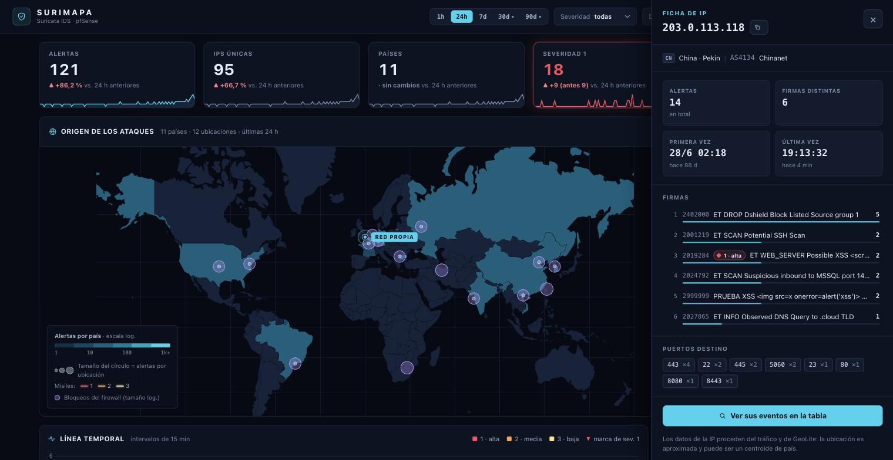
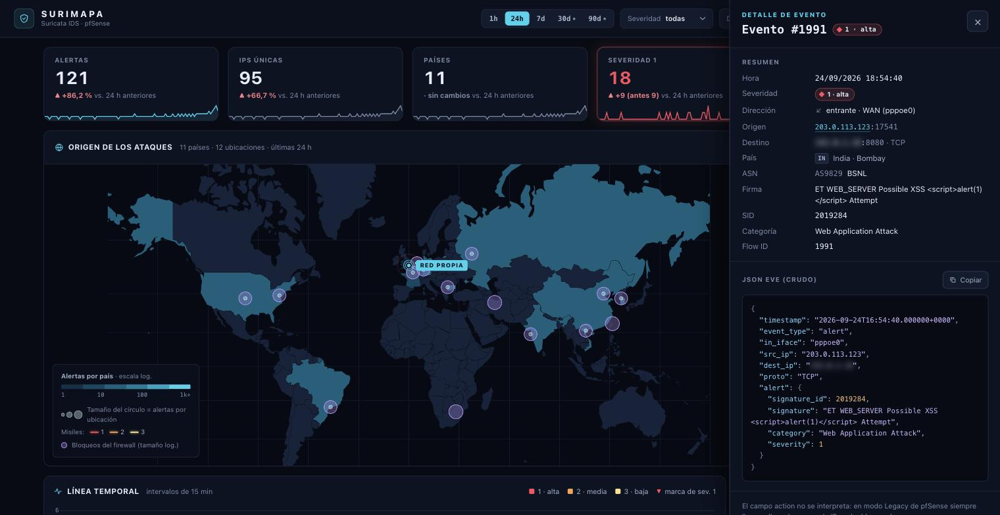
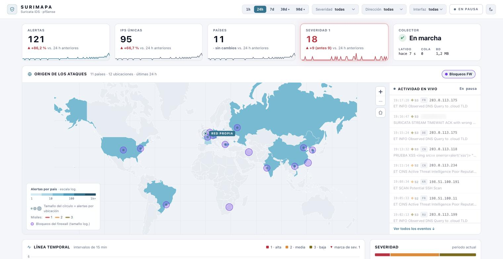

# Surimapa

**English** · [Español](README.es.md)

A lightweight, self-hosted web portal to **see the attacks your Suricata IDS detects** — on a world map, in timelines, rankings and a searchable event table — plus the **packets your pfSense firewall blocks**.

It is a small, home-lab sized replacement for the usual *Redis + Vector + Loki + Grafana* stack, built with a handful of simple pieces that run in Docker in about **150–250 MB of RAM**.



| | |
|---|---|
|  Firewall blocks |  Event table with search and CSV export |
|  IP sheet |  Event detail with raw EVE JSON |
|  Light theme | |

*Screenshots use synthetic data (documentation IP ranges); local and own IP addresses are blurred.*

---

## What it does

- **World map** of attack origins: countries shaded on a log scale, circles per city, and animated "missiles" from the attacker to your network for live alerts. Click a country or circle to filter the event table.
- **Firewall layer** (optional): packets blocked by pfSense on the WAN, received over syslog, drawn as a second layer on the same map, with their own card (totals, top IPs, top ports).
- **KPIs** with comparison to the previous period, collector health, severity breakdown, timeline with severity-1 markers.
- **Rankings**: signatures, remote IPs (with AS organisation), countries, ASNs, destination ports.
- **Event table** with search (IP, SID or signature text), filters (range, severity, direction, interface), paging, **CSV export** of the current view, and a side panel with the full (reduced) EVE JSON and an **IP sheet**.
- **Live mode** via Server-Sent Events.
- Dark and light themes, mobile layout.

The user interface is in **Spanish**; the documentation is in English and Spanish.

## How it works

```
 Suricata (pfSense, OPNsense, Linux…) ──EVE JSON──► Redis (list) ──► collector ──► SQLite ◄── portal ──► browser
 pfSense firewall ──filterlog over UDP syslog──────────────────────► collector        (FastAPI + vanilla JS)
                                                  GeoLite2 (MaxMind) ──┘
```

| Piece | Role | Tech |
|---|---|---|
| `redis` | Buffer that Suricata writes to (list, LPUSH) | `redis:7-alpine`, ACLs |
| `collector` | Reads alerts, validates and normalises them, adds GeoIP (country, city, ASN), stores them; listens for firewall syslog; retention and daily backups | Python 3.12 |
| SQLite | Storage (WAL, covering indexes) | single file |
| `portal` | REST API + SSE + static single-page UI (Leaflet, Chart.js, no framework, no CDN) | FastAPI |
| `geoipupdate` | Keeps the free GeoLite2 databases up to date | official MaxMind image |

## Security model

Surimapa handles **untrusted data** (an attacker controls much of what an IDS logs):

- Parameterised SQL only; strict validation of every field; text truncated and control characters stripped.
- Packet payloads are **never stored**.
- The frontend inserts data with `textContent` only (no `innerHTML`), under a strict Content-Security-Policy (`default-src 'self'`), with no third-party requests.
- The portal has a login page: password stored only as a scrypt hash, delay on failure, session cookie `Secure`/`HttpOnly`/`SameSite=Strict`, same-origin check on POST. It refuses to start without credentials and is served only through an HTTPS reverse proxy. **Do not expose it to the Internet**: use it on your LAN or through a VPN (WireGuard, Tailscale…).
- Redis uses ACLs: the anonymous user (Suricata) can only `LPUSH`/`RPUSH`/`PING` the alert key; reading requires a password.
- The firewall syslog listener only accepts datagrams from the configured firewall IP.
- Containers run as a non-root user with memory limits.

## Getting started

1. Read the **[deployment guide](docs/en/DEPLOYMENT.md)** — Docker Compose on any Linux host or NAS (Synology notes included).
2. Send data to it: **[data sources guide](docs/en/SOURCES.md)** — pfSense, OPNsense, standalone Suricata, UniFi and others.
3. API reference: **[docs/en/API.md](docs/en/API.md)**.

Quick look without any firewall (synthetic data, Python 3 only):

```bash
python3 scripts/mock_api.py      # then open http://127.0.0.1:8099
```

## Development

```bash
# tests (same Python as the containers)
docker run --rm -v "$PWD":/src:ro -w /src -e PYTHONDONTWRITEBYTECODE=1 python:3.12-slim \
  sh -c 'pip install -q pytest -r deploy/collector/requirements.txt -r deploy/portal/requirements.txt httpx && python -m pytest -q -p no:cacheprovider tests'

# inject sample EVE alerts into a local Redis (needs: pip install redis)
python3 scripts/send_test_events.py --redis-url redis://127.0.0.1:6379/0 --count 200 --rate 20
```

## License

Surimapa is free software under the **GNU General Public License v3.0** — see [LICENSE](LICENSE).
Bundled third-party components keep their own licenses — see [THIRD_PARTY.md](THIRD_PARTY.md).

This product includes GeoLite2 data created by MaxMind, available from <https://www.maxmind.com> (downloaded by each installation with its own free account; not included in this repository).
